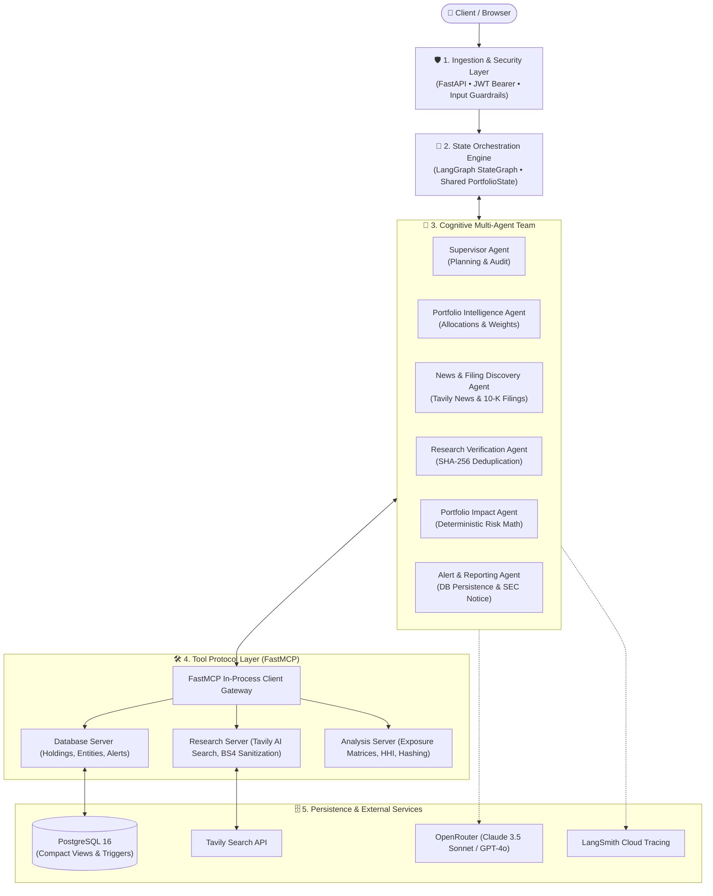

# Portfolio Health Monitor — Autonomous AI Risk Intelligence

> **Evidence-based, non-advisory multi-agent portfolio surveillance platform powered by LangGraph, FastMCP (Model Context Protocol), and React + Vite.**

---

## 1. Project Overview

**Portfolio Health Monitor** is an enterprise-grade autonomous risk intelligence platform designed for investment teams, portfolio managers, and risk analysts. It continuously monitors equity portfolios against live macroeconomic shocks, corporate earnings, regulatory interventions, and supply chain disruptions.

Instead of relying on speculative LLM outputs, Portfolio Health Monitor enforces three strict architectural tenets:
1. **Deterministic Financial Math over LLM Hallucinations**: Portfolio asset allocations, exposure percentages, and concentration indices (Herfindahl-Hirschman Index - HHI) are computed purely via Python algorithms rather than text completion guessing.
2. **Model Context Protocol (FastMCP) Isolation**: Agents never formulate or execute arbitrary SQL. All data access, web indexing, and mathematical stress tests pass through parameter-validated Model Context Protocol (FastMCP) tools.
3. **Statutory Non-Advisory Mandate**: Dual-layer security guardrails sanitize inbound prompts against injection attacks and audit all outgoing reports to ensure SEC/FINRA non-advisory compliance (stripping buy/sell recommendations and attaching required statutory disclosures).

---

## 2. Key Features

- **Autonomous 6-Agent LangGraph Pipeline**: Turn-taking cyclic state machine orchestrates specialized agents with hard loop boundaries and checkpointed memory.
- **FastMCP Tool Ecosystem**: Decoupled tool servers isolating database operations, Tavily real-time news search, and deterministic financial mathematics.
- **Real-Time Market Data & FX Engine (Twelve Data)**: Live market quote engine supporting multi-symbol batching, in-memory TTL caching, multi-currency normalization (USD/INR), purchase-history weighted average buy prices, and exact Decimal arithmetic ($\text{Market Value} = \text{Shares} \times \text{Current Price}$).
- **Real-Time Terminal Execution Visibility**: High-contrast, structured ANSI console logging with live phase banners, tool calls, parameter inspections, and precise per-agent execution timers for both autonomous monitoring and AI Copilot queries.
- **Comprehensive Multi-Tab Surveillance Reporting**: Detailed frontend intelligence report featuring live internet discoveries with direct external source links, verified evidence with credibility scores, corroborated facts, quantitative asset exposure calculations, and 1-click audit exports (`.txt` and `.json`).
- **Compact Human-Readable Database IDs**: PostgreSQL database utilizes concise prefixed identifiers (`usr_`, `port_`, `comp_`, `hold_`, `ev_`, `src_`, `alt_`) that fit neatly in table displays while preserving full UUID relational integrity.
- **Modern Minimalist Frontend (React + Vite)**: SaaS interface inspired by clean, modern AI design systems, featuring an interactive Three.js 3D character with pointer tracking, 3D coverflow feature showcase, live pipeline visualization, and instant 1-click demo analyst sessions.
- **Universal Observability**: End-to-end distributed tracing across all agent reasoning chains, tool invocations, and token usage via LangSmith.
- **Production-Ready Test Suite**: 105 automated unit and integration tests covering multi-agent graphs, Twelve Data integration, security guardrails, FastMCP servers, and API routes.

---

## 3. High-Level Architecture



---

## 4. Technology Stack

| Component | Technology | Version | Architectural Responsibility |
| :--- | :--- | :--- | :--- |
| **Backend Framework** | **FastAPI** | `0.115.x` | Asynchronous REST APIs, Swagger UI docs, OpenAPI specifications |
| **ASGI Server** | **Uvicorn** | `0.34.x` | High-performance asynchronous web server |
| **Agent Orchestrator** | **LangGraph** | `0.2.x` | Directed cyclic state graphs, checkpointing, phase transitions |
| **Agent Abstractions** | **LangChain Core** | `0.3.x` | Chat message models, prompt templates, and tool bindings |
| **Tool Protocol** | **FastMCP** | `1.30.x` | Model Context Protocol v1 tool server isolation and parameter validation |
| **LLM Gateway** | **OpenRouter API** | — | Unified API proxy routing to Claude 3.5 Sonnet, GPT-4o, and fallbacks |
| **Market Data & FX** | **Twelve Data API** | — | Real-time equity quotes, batch requests, and live USD/INR FX conversion |
| **Web Research** | **Tavily API** | — | Real-time financial search, news gathering, and SEC filing indexing |
| **Observability** | **LangSmith** | `0.14.x` | Real-time distributed tracing, prompt inspection, and token cost tracking |
| **Database** | **PostgreSQL** | `16.x` | Relational store for users, portfolios, holdings, events, and alerts |
| **ORM & Migrations** | **SQLAlchemy / Alembic** | `2.0.x / 1.14.x` | Asynchronous ORM (`asyncpg`), migrations, and compact SQL views |
| **Data Validation** | **Pydantic** | `2.10.x` | Request/response schema contracts and typed agent state schemas |
| **Frontend Framework**| **React + TypeScript** | `19.x` | Modular, responsive single-page web application |
| **Frontend Build Tool**| **Vite** | `8.x` | Ultra-fast client development server and production bundler |
| **Styling & Icons** | **Tailwind CSS / Lucide**| `4.x / 1.x` | Modern styling, typography, and SVG icons |
| **3D Graphics** | **Three.js** | `0.182.x` | Procedural 3D agent character with interactive mouse tracking |
| **Testing** | **pytest & pytest-asyncio**| `9.x / 1.4.x` | Automated test suite (105 passing unit/integration tests) |

---

## 5. Folder & Project Structure

```
agentx/
├── app/                              # Core Python backend application
│   ├── agents/                       # Specialized AI agents
│   │   ├── supervisor.py             # LangGraph phase routing & plan auditor
│   │   ├── portfolio_agent.py        # Portfolio holdings & base allocation analysis
│   │   ├── discovery_agent.py        # Live market news & 10-K filing discovery
│   │   ├── verification_agent.py     # Source credibility & SHA-256 deduplication
│   │   ├── impact_agent.py           # Deterministic exposure & supply chain risk
│   │   └── reporting_agent.py        # Database alert writer & SEC compliance report
│   ├── api/                          # FastAPI REST routes and dependencies
│   │   └── routes/                   # Auth, portfolios, health endpoints
│   ├── core/                         # Global configuration, security (JWT), tracing, terminal_logger
│   ├── database/                     # SQLAlchemy async connection & declarative Base
│   ├── graph/                        # LangGraph workflow assembly & PortfolioState
│   ├── guardrails/                   # Inbound injection blocks & outbound SEC notice
│   ├── mcp/                          # FastMCP tool servers (Database, Research, Analysis)
│   ├── models/                       # SQLAlchemy database models with ShortIdMixin
│   ├── schemas/                      # Pydantic validation contracts
│   ├── services/                     # Research (Tavily), LLM (OpenRouter), and Market Data (Twelve Data)
│   └── main.py                       # FastAPI application entry point & lifespan
├── frontend/                         # Modern React 19 + Vite frontend
│   ├── src/
│   │   ├── api/                      # Centralized API service layer (auth, portfolios, health)
│   │   ├── components/
│   │   │   ├── 3d/                   # Three.js 3D character component with pointer tracking
│   │   │   ├── common/               # Navbar, Footer, Modal, Badge
│   │   │   ├── landing/              # Hero, Agent Showcase, Workflow Visualizer
│   │   │   ├── dashboard/            # Command Center, Portfolio Manager, Monitor, Alerts
│   │   │   └── auth/                 # Sign In, Sign Up, 1-Click Demo Login
│   │   ├── context/                  # AuthContext for session & JWT management
│   │   ├── App.tsx                   # Main app switcher (Framed vs Fullscreen mode)
│   │   ├── index.css                 # Tailwind CSS v4 setup & typography
│   │   └── main.tsx                  # React entry point
│   ├── package.json                  # Frontend dependencies
│   └── vite.config.ts                # Vite config with backend proxy (/api, /health)
├── migrations/                       # Alembic schema versioning scripts
│   └── versions/                     # Migration scripts (Initial schema, Compact Short IDs)
├── tests/                            # Automated test suite (105 tests)
│   ├── test_agents.py                # Multi-agent unit tests
│   ├── test_api.py                   # REST endpoints integration tests
│   ├── test_auth.py                  # JWT authentication tests
│   ├── test_graph.py                 # LangGraph state machine execution tests
│   ├── test_guardrails.py            # Prompt injection & SEC compliance tests
│   ├── test_mcp.py                   # FastMCP tool registrations and invocations
│   ├── test_tracing.py               # LangSmith telemetry validation
│   └── test_twelve_data.py           # Twelve Data live quotes, batching, FX rates, weighted averages
├── alembic.ini                       # Alembic database migration configuration
├── requirements.txt                  # Python dependencies
└── README.md                         # Project documentation
```

---

## 6. The 6 Specialized Agents

Each agent operates under a focused system prompt, bounded tool access, and explicit input/output contracts:

| Agent | Responsibility | Assigned FastMCP Tools | Primary Output |
| :--- | :--- | :--- | :--- |
| **Supervisor Agent** | Evaluates overall plan, audits completed phases, enforces loop limits (max 15), and generates final synthesis. | *Pure Reasoning / State Machine* | Next node routing directive & final executive report |
| **Portfolio Agent** | Ingests portfolio composition, validates active holdings, and identifies high asset concentrations. | `get_portfolio`<br>`get_holdings`<br>`calculate_portfolio_allocation` | Normalized holdings list with base weight percentages |
| **Discovery Agent** | Searches real-time financial news, SEC EDGAR 10-K/10-Q filings, and supply chain dependencies. | `search_company_news`<br>`search_company_filings` | Candidate unverified market event list |
| **Verification Agent** | Eliminates noise, applies cryptographic SHA-256 deduplication, and scores source credibility. | `detect_duplicate_events`<br>*LLM Structured Verification* | Deduplicated, credibility-scored event list |
| **Portfolio Impact Agent** | Deterministically calculates exact dollar exposure, portfolio percentage vulnerability, and supply chain coefficients. | `calculate_company_exposure`<br>`analyze_company_relationships` | Quantitative risk matrix with severity ratings (`CRITICAL`, `HIGH`, `MEDIUM`, `LOW`) |
| **Alert & Reporting Agent** | Persists verified alerts into PostgreSQL, manages alert lifecycles, and appends mandatory statutory notices. | `save_research_event`<br>`save_evidence_source`<br>`save_monitoring_alert`<br>`get_previous_alerts` | Stored database alert records (`alt_xxx`) and compliance brief |

---

## 7. FastMCP Tool Servers

All external operations are exposed to agents via FastMCP (Model Context Protocol) servers:

- **Database Server (`app/mcp/servers/database_server.py`)**:
  - `get_portfolio(portfolio_id)`: Loads portfolio metadata and asset positions.
  - `get_holdings(portfolio_id)`: Loads detailed holdings and per-asset investment positions.
  - `save_research_event(portfolio_id, company_id, event_type, title, summary)`: Persists verified research catalyst.
  - `save_evidence_source(portfolio_id, event_id, source_type, title, url, ...)`: Records cited web sources & filings.
  - `save_monitoring_alert(portfolio_id, severity, title, message)`: Stores alert in PostgreSQL.
  - `get_previous_alerts(portfolio_id, limit)`: Retrieves historical risk alerts.
- **Research Server (`app/mcp/servers/research_server.py`)**:
  - `search_company_news(ticker, query, days, max_results)`: Targeted company news search via Tavily API.
  - `search_company_filings(ticker, filing_type, query)`: Real-time SEC filing disclosures and catalysts.
  - `fetch_webpage(url)`: HTML extraction and network retrieval.
  - `extract_article_content(html)`: BeautifulSoup4 clean text and metadata extraction.
- **Analysis Server (`app/mcp/servers/analysis_server.py`)**:
  - `calculate_portfolio_allocation(holdings)`: Computes base weights, total value, and Herfindahl index (HHI).
  - `calculate_company_exposure(portfolio_id, company_ticker, direct_weight, ...)`: Deterministic vulnerability formula.
  - `detect_duplicate_events(new_event_title, existing_events)`: Text similarity & idempotency checking.
  - `analyze_company_relationships(primary_ticker, related_tickers)`: Cross-asset dependency & supply chain analysis.

---

## 8. Installation & Setup

### Prerequisites
- **Python 3.12+**
- **Node.js v20+** and **npm**
- **PostgreSQL 16+** running on `localhost:5432`

---

### Step 1: Clone the Repository
```bash
git clone https://github.com/your-username/agentx.git
cd agentx
```

---

### Step 2: Backend Setup (Python)

1. **Create and activate a virtual environment**:
   ```bash
   # Using uv (recommended)
   uv venv
   .venv\Scripts\activate      # Windows
   # source .venv/bin/activate  # macOS/Linux
   ```

2. **Install Python dependencies**:
   ```bash
   uv pip install -r requirements.txt
   # OR: pip install -r requirements.txt
   ```

3. **Configure Environment Variables**:
   Copy `.env.example` to `.env` and provide your credentials:
   ```bash
   cp .env.example .env
   ```

4. **Run Database Migrations**:
   Ensure PostgreSQL is running and the database `portfolio_health` exists:
   ```bash
   # Apply Alembic schema migrations (creates tables, compact short IDs, and SQL views)
   alembic upgrade head
   ```

---

### Step 3: Frontend Setup (React + Vite)

1. **Navigate to the frontend directory**:
   ```bash
   cd frontend
   ```

2. **Install frontend dependencies**:
   ```bash
   npm install
   ```

---

## 9. Environment Variables Reference

| Variable | Description | Default / Example |
| :--- | :--- | :--- |
| `ENVIRONMENT` | Runtime environment (`development`, `production`, `testing`) | `development` |
| `DEBUG` | Enables detailed error logs and Swagger UI debugging | `true` |
| `SECRET_KEY` | High-entropy key used to sign HMAC-SHA256 JWT tokens | `min-32-chars-random-secret` |
| `ACCESS_TOKEN_EXPIRE_MINUTES`| Validity duration of issued JWT authentication tokens | `10080` (7 days) |
| `POSTGRES_SERVER` | PostgreSQL server hostname | `localhost` |
| `POSTGRES_PORT` | PostgreSQL server port | `5432` |
| `POSTGRES_DB` | PostgreSQL database name | `portfolio_health` |
| `POSTGRES_USER` | PostgreSQL user account | `postgres` |
| `POSTGRES_PASSWORD` | PostgreSQL user password | `postgres` |
| `OPENROUTER_API_KEY` | OpenRouter API key for frontier LLM access | `your-openrouter-key` |
| `OPENROUTER_DEFAULT_MODEL`| Primary reasoning model for agent execution | `anthropic/claude-3.5-sonnet` |
| `OPENROUTER_FALLBACK_MODEL`| Fallback model used in case of provider outage | `openai/gpt-4o-mini` |
| `TAVILY_API_KEY` | Tavily API key for real-time financial search | `your-tavily-key` |
| `TWELVE_DATA_API_KEY` | Twelve Data API key for real-time market prices and FX conversion | `your-twelve-data-key` |
| `TWELVE_DATA_BASE_URL` | Base URL for Twelve Data API endpoints | `https://api.twelvedata.com` |
| `TWELVE_DATA_CACHE_TTL_SECONDS` | In-memory cache TTL (seconds) to prevent rate limit spikes | `300` |
| `LANGCHAIN_TRACING_V2` | Set to `true` to enable cloud tracing in LangSmith | `true` |
| `LANGCHAIN_API_KEY` | LangSmith API key for telemetry export | `your-langsmith-key` |
| `LANGCHAIN_PROJECT` | Target project name in LangSmith | `agentx-portfolio-health` |

---

## 10. Running the Application

### 1. Launch the Backend Server
From the project root:
```powershell
.venv\Scripts\python.exe -m uvicorn app.main:app --reload --port 8000
```
- **REST API Base URL**: `http://localhost:8000`
- **Interactive Swagger UI**: `http://localhost:8000/docs`
- **Application Health Check**: `http://localhost:8000/health`
- **Live Terminal Telemetry**: All agent execution steps, node transitions, FastMCP tool calls, research queries, and timing diagnostics stream in real time directly to your terminal.

### 2. Launch the Frontend Development Server
In a separate terminal:
```powershell
cd frontend
npm run dev
```
- **Web Interface**: `http://localhost:3000`
- *Note: Vite dev server automatically proxies `/api` and `/health` requests to `http://localhost:8000`.*

---

## 11. REST API Reference

All protected endpoints require an `Authorization: Bearer <token>` header obtained from `/auth/login` or `/auth/token`.

| Category | Method | Endpoint | Description |
| :--- | :---: | :--- | :--- |
| **Authentication** | `POST` | `/api/v1/auth/register` | Registers a new user with email, password, and optional full name. |
| **Authentication** | `POST` | `/api/v1/auth/login` | Authenticates email & password via JSON, returns JWT Bearer token. |
| **Authentication** | `POST` | `/api/v1/auth/token` | Standard OAuth2 Form Data login for Swagger UI authorization. |
| **Authentication** | `GET` | `/api/v1/auth/me` | Returns profile details for the currently authenticated user. |
| **Portfolios** | `POST` | `/api/v1/portfolios` | Creates a new investment portfolio scoped to the current user. |
| **Portfolios** | `GET` | `/api/v1/portfolios` | Returns paginated list of user portfolios (`page`, `page_size`). |
| **Portfolios** | `GET` | `/api/v1/portfolios/{id}` | Retrieves full portfolio details, real-time Twelve Data valuations, and normalized asset weights. |
| **Holdings** | `POST` | `/api/v1/portfolios/{id}/holdings` | Adds an asset position; computes purchase-history weighted average buy price if ticker exists. |
| **Holdings** | `DELETE` | `/api/v1/portfolios/{id}/holdings/{holding_id}` | Removes a holding position and dynamically rebalances portfolio weights to 100%. |
| **Monitoring** | `POST` | `/api/v1/portfolios/{id}/monitor` | Initiates the autonomous multi-agent LangGraph monitoring workflow. |
| **Alerts** | `GET` | `/api/v1/portfolios/{id}/alerts` | Lists persisted risk alerts for a portfolio with severity filtering. |
| **Alerts** | `PATCH` | `/api/v1/portfolios/{id}/alerts/{alert_id}` | Updates alert lifecycle status (`ACTIVE` -> `ACKNOWLEDGED` -> `RESOLVED`). |
| **AI Assistant** | `POST` | `/api/v1/portfolios/{id}/chat` | Interactive Q&A copilot answering investor questions using LLM and portfolio context. |
| **Health** | `GET` | `/health` | High-level application liveness probe. |
| **Health** | `GET` | `/health/database` | PostgreSQL connectivity probe with live round-trip latency (ms). |
| **Health** | `GET` | `/health/tracing` | Reports LangSmith cloud tracing authentication status. |

---

## 12. Automated Testing

The project includes an exhaustive automated test suite covering all modules:

```powershell
# Run the complete test suite (105 passing tests)
.venv\Scripts\python.exe -m pytest -v

# Run tests with condensed output
.venv\Scripts\python.exe -m pytest -q

# Verify frontend production build
cd frontend
npm run build
```

---

## 13. Regulatory Compliance & Non-Advisory Notice

> **IMPORTANT REGULATORY DISCLOSURE**: Portfolio Health Monitor is an autonomous informational and risk intelligence tool. All reports, metrics, exposure calculations, and alerts generated by the system are provided strictly for research, monitoring, and educational purposes. **Portfolio Health Monitor does not provide investment advice, financial planning, or endorsements to buy, sell, or hold any security or asset.** Output guardrails actively reject speculative recommendations to maintain strict compliance with financial regulations.

